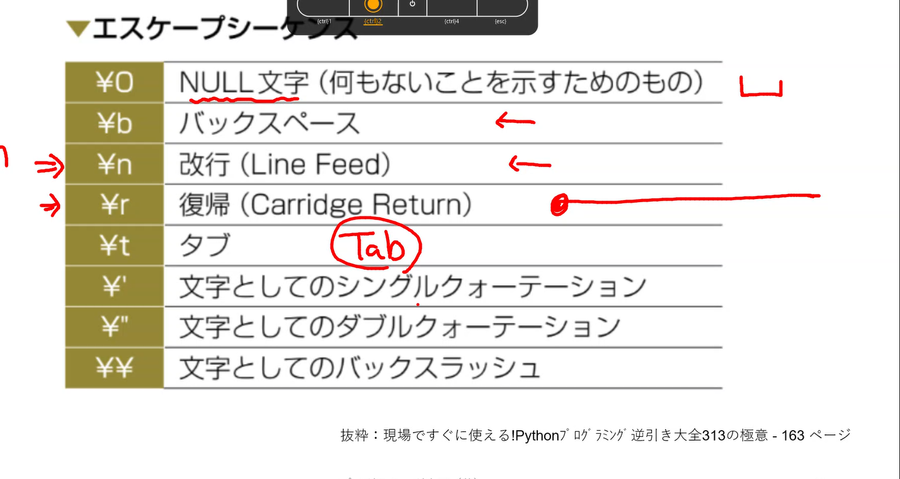

colors = ['red', 'green', 'blue'] # 0 = red, 1 = green, 2 = blue

w = 'こんにちは。' + '私はパイソンです。' 
<!-- w[0] = こ, w[14] = 。 w[-15] = こ、w[-1] = 。w[6:12] = 私はパイソンです, w[-3:] = です。 コロンで範囲を指定ー３:は-3より後ろという意味 -->

## slicing(スライシング)
文字列の特定の範囲を切り取れる
:を使う
変数名[:n]で0からn - 1までの要素を一度に参照する

例) [0:3] -> 0, 1, 2

## エスケープシーケンス

